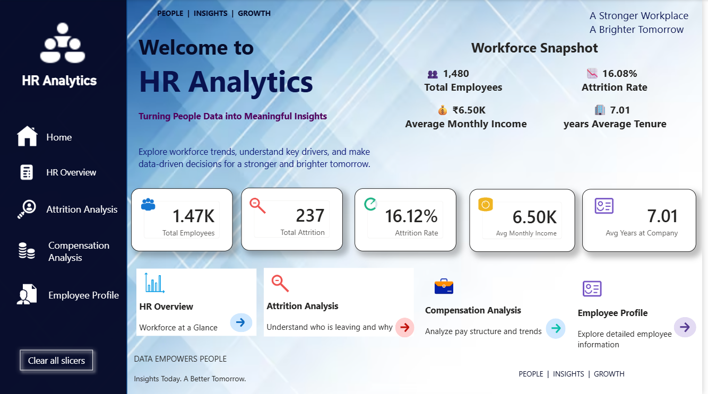

# HR Analytics Dashboard

## 📊 Project Overview

HR Analytics Dashboard is an interactive **Power BI dashboard** designed to analyze employee data, attrition, demographics, job roles, salary, and employee retention.

## 🎯 Objectives

* Analyze employee workforce data
* Identify employee attrition patterns
* Analyze attrition by department and job role
* Understand employee demographics
* Analyze salary and income trends
* Study employee experience and tenure
* Track employee retention
* Create an interactive HR analytics dashboard

## 🛠️ Tools & Technologies

* **Power BI**
* **Power Query**
* **DAX**
* **Microsoft Excel**
* **CSV Dataset**

## 📂 Project Structure

```text
HR-Analytics/
│
├── HR_Analytics_Dashboard.pbix
├── hr_analytics.csv
├── Screenshots/
│   └── dashboard.png
└── README.md
```

## 📌 Dashboard KPIs

* **Total Employees**
* **Total Attrition**
* **Employee Retained**
* **Attrition Rate**
* **Average Monthly Income**
* **Average Years at Company**

## 📈 Dashboard Analysis

### 1. Employee Overview

* Total employee count
* Employee distribution
* Department-wise employees
* Job role analysis

### 2. Attrition Analysis

* Attrition by department
* Attrition by job role
* Attrition by gender
* Attrition by education
* Attrition by age group
* Attrition by salary
* Attrition by years at company

### 3. Employee Demographics

* Gender
* Age
* Education
* Marital status
* Department
* Job role

### 4. Salary Analysis

* Average monthly income
* Income by department
* Income by job role
* Salary distribution

## 🧹 Data Cleaning

Data cleaning and transformation were performed using **Power Query**.

### Cleaning Steps

* Removed duplicate records
* Handled missing values
* Changed incorrect data types
* Cleaned text values
* Converted numerical columns
* Created Employee Key
* Created required calculated fields
* Validated categorical values

## 🧮 DAX Measures

### Total Employees

```DAX
Total Employees =
COUNTROWS(hr_analytics)
```

### Total Attrition

```DAX
Total Attrition =
CALCULATE(
    COUNTROWS(hr_analytics),
    hr_analytics[Attrition_Flag] = 1
)
```

### Employee Retained

```DAX
Employee Retained =
CALCULATE(
    COUNTROWS(hr_analytics),
    hr_analytics[Attrition_Flag] = 0
)
```

### Attrition Rate

```DAX
Attrition Rate =
DIVIDE(
    [Total Attrition],
    [Total Employees],
    0
)
```

### Average Monthly Income

```DAX
Average Monthly Income =
AVERAGE(hr_analytics[MonthlyIncome])
```

## 📊 Visualizations

The dashboard contains:

* KPI Cards
* Bar Charts
* Column Charts
* Donut Charts
* Tables
* Matrix Visuals
* Slicers
* Interactive Filters

## 🔍 Business Questions

This dashboard helps answer:

* What is the total number of employees?
* What is the overall attrition rate?
* Which department has higher attrition?
* Which job roles have higher attrition?
* How does salary relate to attrition?
* Which age groups have higher attrition?
* How does employee experience affect attrition?
* What is the employee retention rate?

## 🎨 Dashboard Features

* Interactive slicers
* Dynamic KPI cards
* Department-wise analysis
* Job role analysis
* Attrition analysis
* Employee demographics
* Salary analysis
* Interactive charts


## 📷 Dashboard Preview

Add your dashboard screenshot:

```markdown

```

## 💡 Skills Demonstrated

* Power BI
* Power Query
* DAX
* Data Cleaning
* Data Transformation
* Data Visualization
* Exploratory Data Analysis
* KPI Development
* Dashboard Development
* HR Analytics
* Business Intelligence

## 👩‍💻 Author

### Mahima Kamatwar

**Aspiring Data Analyst**

* GitHub: https://github.com/Mahima-Kamatwar
* LinkedIn: https://linkedin.com/in/mahima-kamatwar-908875287
* Email: [mahimakamatwar.785@gmail.com](mailto:mahimakamatwar.785@gmail.com)


